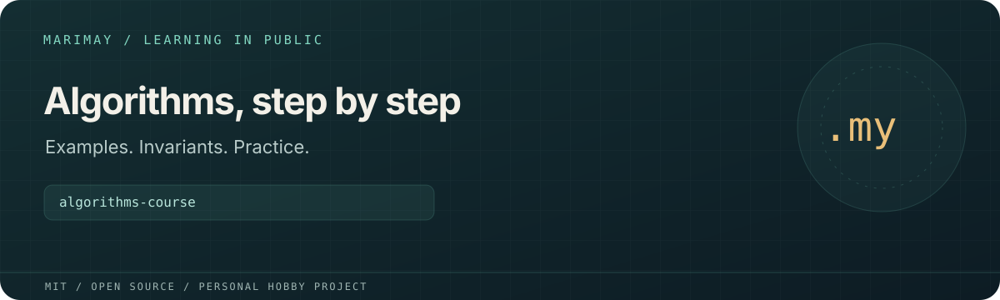

# algorithms-course



> **Personal learning project.** This open-source MIT project is part of
> [Marimay](https://github.com/marimay-lang/marimay), my hobby programming-language project.
> I maintain it in my spare time to learn by building. APIs and tooling may
> change, and progress may be intermittent.

A worked algorithms and data-structures course using the currently implemented
Marimay preview. Read a lesson, trace its invariant, run the example, then study
the tests and try the exercise. The implementations form a broad foundation;
the catalogue is open-ended rather than an exhaustive list of computable algorithms.

## Lessons

| Lesson | Worked material |
|---|---|
| [01 — Linear scan](notes/01-cost-model-and-linear-scan.md) | Cost model, invariant, first-occurrence search exercise |
| [02 — Searching](examples/02-searching/README.md) | Linear and last-occurrence search, binary bounds, jump and exponential search |
| [03 — Sorting](examples/03-sorting/README.md) | Comparison sorts, iterative merge/quick sorts, counting, bucket and radix sorts |
| [04 — Data structures](examples/04-data-structures/README.md) | Stack, FIFO queue, binary min-heap, disjoint-set union |
| [05 — Sequences](examples/05-sequences/README.md) | Min/max, reversal, rotation, prefix/range sums, deduplication, sliding maximum |
| [06 — Hashing](examples/06-hashing/README.md) | Frequencies, stable uniqueness, two-sum, multiset intersection, majority vote |
| [07 — Number theory](examples/07-number-theory/README.md) | GCD/LCM, powers, primes, sieve, factorization, binomial coefficients, square root |
| [08 — Graphs](examples/08-graphs/README.md) | Traversals, components, topological order, paths, spanning trees, coloring, SCCs |
| [09 — Range queries](examples/09-range-queries/README.md) | Fenwick tree, iterative segment tree, sparse table |
| [10 — Dynamic programming](examples/10-dynamic-programming/README.md) | Coins, knapsack, subsequences, edit distance, subarrays, subset sum |
| [11 — Text](examples/11-text/README.md) | Naive/KMP search, Z function, palindromes, run-length encoding, distinct windows |
| [12 — Greedy algorithms](examples/12-greedy/README.md) | Interval selection/union, minimum jumps, optimal merge cost |

Reusable implementations and focused tests live in [`algorithms/`](algorithms/).
Each numbered directory in [`examples/`](examples/) has a runnable `main.my`.
[`CATALOG.md`](CATALOG.md) lists the exported algorithms, contracts and costs.
[`notes/progress.md`](notes/progress.md) separates available material from personal mastery.

## Run the current build

```sh
export MMAY=/absolute/path/to/marimay/build/debug/mmay
"$MMAY" run ./examples/02-searching
"$MMAY" test . --engine both
python3 tools/verify_algorithms.py --output build/verification.json
```

The verification command checks formatting and all targets, confirms that every
declared test ran in VM/native comparison mode, and runs **every lesson** in the
VM and as debug/release native executables. It compares each example's exact
output against [`lessons.json`](lessons.json). It records the compiler version,
binary hash, source hash, host and test names in the optional JSON report.
Python 3.9+ and a C compiler usable by `mmay build` are required. You may instead
put `mmay` on `PATH`, or pass `--mmay /absolute/path/to/mmay`.

```sh
python3 -m unittest discover -s tools -p 'test_*.py'
"$MMAY" fmt . --check
"$MMAY" check . --all-targets
```

The course targets Marimay `0.1.0-alpha.1` / `0.1-design`. Algorithms use arrays,
nominal records, enums, `Option`/`Result`, checked integer arithmetic, maps/sets
and Unicode scalar arrays. Implementations are iterative because the current
native emitter rejects recursive call graphs. Text positions count Unicode
scalars; they do not promise grapheme or UTF-8 byte offsets. Expected invalid
inputs and arithmetic overflow are documented per API. Runtime resource limits
still apply to large inputs; these are teaching implementations, not hardened
unbounded-input services.

The [2026-11-08 local verification record](notes/verification-2026-11-08.md)
covers 66 VM/native tests and all 12 lessons in three execution profiles.
Local verification is evidence for the recorded compiler and machine. CI also
builds the public compiler and runs the whole course on Linux. This does not
constitute a language release or acceptance on all supported platforms.

## How to study

1. Write down the input domain and a small hand-worked example.
2. State what remains true after each loop iteration.
3. Predict time and auxiliary space, including the chosen representation.
4. Read the implementation and explain its boundary/error branches.
5. Run the focused tests; add a case that would break an incorrect variant.
6. Solve the lesson's follow-up before consulting its reference implementation.

Several starting implementations were adapted from the MIT-licensed
[algorithm-benchmarks](https://github.com/marimay-lang/algorithm-benchmarks/tree/main/marimay)
reference corpus. The course adds explanations, exercises, boundary tests and
broader implementations. Benchmark methodology and historical measurements
remain in that repository.

## License

[MIT](LICENSE). Existing copyright attribution is retained.
